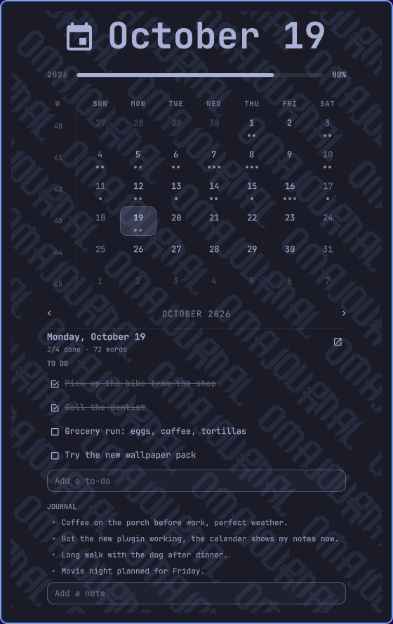

# OmaJournal

the Omarchy bar clock, but its calendar shows my [Obsidian](https://obsidian.md) daily notes.

every day that has a note gets the same little dots Obsidian's calendar shows. click a day and its to-dos and journal show up right under the calendar. tick to-dos off, add new ones, jot a note, or jump straight into Obsidian for the whole thing.



## what it does

it's the stock clock with the stock calendar drop-down, plus your daily notes.

- **dots like Obsidian's.** one dot for every 250 words in that day's note (1 to 5), plus a hollow dot when the note still has open to-dos. same rule as Obsidian's Calendar plugin, so both calendars match.
- **click a day** to see it under the calendar: the date, how many to-dos are done, and the word count.
- **to-dos.** click one to tick it off (or back on). type in **Add a to-do** and hit Enter to add one.
- **journal.** the newest lines from that day's journal. type in **Add a note** and hit Enter to add a line. **Read it all in Obsidian** opens the full note.
- **open in Obsidian.** double-click a day, press `o`, or hit the open button next to the date.
- **no note that day?** **Make note** makes it from your Daily notes template.

everything else works like the stock clock: arrows or the scroll wheel change the month, `t` goes back to today, right-click the clock to change how it shows the time.

## how it fits your notes

it reads your vault's own Daily notes settings (Settings › Daily notes in Obsidian): the folder, the file name format and the template. so it finds your notes wherever you keep them.

when it adds something, it keeps notes in this order:

```
## To do      ← to-dos go here, at the top
## Journal    ← notes go here (or ## Notes, if that's what you use)
## Next
```

- a new to-do goes after the last one in **To do**. a note without a **To do** section gets one at the top.
- a new note line goes at the end of **Journal** (or **Notes**). a note without one gets a **Journal** section above **Next**.

## install

you need Omarchy 4, Obsidian with the **Daily notes** core plugin turned on, and `python`.

```bash
omarchy plugin add https://github.com/Dankestrick/OmaJournal.git --enable
```

it takes the stock clock's spot in the bar. nothing needs root.

it uses the vault Obsidian has open. to pick a different one, set **Obsidian vault** in the widget's settings, or:

```bash
omarchy bar set io.github.dankestrick.omajournal vaultPath "/path/to/your vault"
```

## keys

| key | does |
| --- | --- |
| `←` `→` | previous / next month |
| `↑` `↓` | previous / next year |
| `t` or `Enter` | back to today |
| `o` | open the picked day in Obsidian |
| `w` | switch which day weeks start on |
| `Esc` | close |

to open the calendar on a day from a script: `qs ipc -p "$OMARCHY_PATH/shell" call omarchy.clock day 2026-10-19`

## Permissions and safety

OmaJournal runs as a normal Omarchy plugin, with your user's permissions.

- **No root steps.** OmaJournal does not use sudo. It does not use pkexec. It installs no services.
- **What it runs.** Its own helper (`helpers/omajournalctl`, plain Python, standard library only), always as an argument list through `timeout`, never through a shell. Each run is capped at 8 seconds. It opens notes in Obsidian with an `obsidian://open` link.
- **What it reads.** Obsidian's vault list (`~/.config/obsidian/obsidian.json`), your vault's Daily notes settings and template, and the daily notes of the month on screen. Only regular files inside the vault, at most 1 MiB each.
- **What it writes.** Only the daily note you change, and only when you tick a to-do, add a to-do or a note, or press **Make note**. Edits are atomic (a temp file in the same folder, then a rename) and keep the file's permissions. An edit only goes through if the note still matches what the calendar last read, so it never overwrites a change you made in Obsidian in the meantime. A new note is created private to you (0600).
- **Typed text.** To-dos and notes you type go to the helper over stdin, never on the command line.
- **What it shows.** Note text is always shown as plain text.
- **Network.** None.

## if something's off

| what you see | fix |
| --- | --- |
| "Couldn't find your Obsidian vault" | open the vault in Obsidian once, or set **Obsidian vault** in the widget settings. |
| no dots at all | turn on **Daily notes** in Obsidian (Settings › Core plugins), and check its folder and date format match your notes. |
| "The note changed since the calendar read it" | you edited the note somewhere else. click the day again and redo it. |

## remove

```bash
omarchy plugin remove io.github.dankestrick.omajournal --yes
```

that puts the stock clock back. your notes stay exactly as they are.

OmaJournal isn't made by or affiliated with Obsidian. the clock and calendar are built from Omarchy's own clock plugin.

## license

[MIT](LICENSE)
